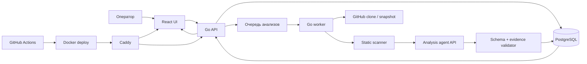

# План: платформа анализа GitHub-репозиториев

## 1. Решение по границам

Текущий проект — статический React-интерфейс, который читает готовый JSON-бандл. Новая задача
добавляет жизненный цикл репозитория, запуск анализов, историю, ручную проверку и деплой.
Поэтому архитектуру нужно расширить до API + worker + хранилище.

Существующий дата-бандл не выбрасываем: он остаётся экспортным форматом, фикстурой для UI и
резервным способом публикации отчётов. Основным источником данных для административного интерфейса
становится API.

## 2. Целевой поток

## 3. Что войдёт в MVP

### Управление репозиториями

- Добавление репозитория по URL.
- Валидация URL и определение хостинга.
- Поддержка публичных GitHub-репозиториев в первом проходе.
- Хранение ветки, последнего SHA, даты добавления и статуса.
- Удаление репозитория с подтверждением.
- Запуск нового анализа и отображение состояния: `queued`, `cloning`, `scanning`, `agent_review`,
  `validated`, `completed`, `failed`.
- Защита от повторного анализа одного и того же SHA без явного перезапуска.

### Анализ

Пайплайн фиксирует конкретный commit SHA и собирает:

- дерево файлов и размер репозитория;
- языки, фреймворки, версии и package manifests;
- lock-файлы, Docker/Compose и CI-конфигурации;
- структуру модулей, границы слоёв и циклические зависимости;
- тесты, lint, typecheck и build-скрипты;
- признаки сложности, дублирования, чрезмерной связанности и неиспользуемой инфраструктуры;
- предупреждения безопасности и prompt injection.

Фактические баллы выставляются только по версионированной рубрике. Каждая метрика получает балл
0–10, confidence, краткое резюме, объяснение и проверяемые evidence-ссылки вида
`path + line_start + line_end`.

### Валидируемый результат агента

Для каждого анализа сохраняются:

- обнаруженный стек;
- результат сборки, тестов, lint и typecheck;
- оценки по категориям и метрикам;
- итоговый score и warnings;
- объяснение «почему это хорошо/плохо»;
- рекомендации;
- commit SHA, версия рубрики, версия prompt/agent и модель;
- сырой ответ агента для ручного разбора.

Пайплайн принимает результат только после двух уровней проверки:

1. детерминированная проверка JSON Schema, диапазонов, обязательных полей и существования файлов;
2. отдельная validation-фаза агента, которая ищет противоречия между баллом, объяснением и evidence.

Невалидный результат не попадает в рейтинг и получает понятную причину ошибки.

### UI

- Реестр репозиториев с поиском, фильтрами и статусами.
- Добавление по ссылке.
- Удаление и повторный запуск.
- Страница репозитория с detected stack, buildability, итоговым баллом и breakdown.
- Таблица метрик с evidence и ссылками на строки репозитория.
- История анализов по SHA.
- Визуальное разделение AI score и ручной оценки.
- Ручная оценка с обязательным комментарием и историей изменений.
- Отдельные состояния загрузки, ошибки, неполные данные и предупреждения.

## 4. Модель данных

Минимальные сущности:

- `repositories` — URL, provider, name, branch, visibility, current SHA, status;
- `analysis_runs` — repository, SHA, rubric version, lifecycle status, timestamps, failure reason;
- `analysis_reports` — normalized JSON result, raw agent result, scores, warnings, evidence;
- `criteria` / `rubrics` — версионированные категории, метрики, веса и anchors;
- `manual_reviews` — ручные баллы, комментарии, автор и timestamp;
- `artifacts` — логи, bundle/export и метаданные сборки.

Для MVP достаточно PostgreSQL и файлового каталога на сервере для clone workspace, логов и больших
артефактов. Очередь можно сделать на PostgreSQL, без Redis, чтобы не добавлять инфраструктуру раньше
времени.

## 5. Безопасность

- Не выполнять код репозитория на хосте без sandbox/ограничений.
- Ограничить размер clone, глубину истории, число файлов, время анализа и размер вывода агента.
- Не передавать агенту секреты окружения и credentials.
- Проверять URL против SSRF и разрешать только поддерживаемые Git-хостинги.
- Приватные репозитории подключать через GitHub App/PAT, хранящийся только в secret storage.
- SSH-ключ деплоя, API-токен агента и GitHub-токены не коммитить и не присылать в чат.
- Добавить rate limit, request size limit и очистку временных clone-каталогов.
- Отдельно отображать подозрение на prompt injection как warning, а не как факт.

## 6. CI/CD и Caddy

### Pull request pipeline

- format check, lint, typecheck и frontend tests;
- тесты Go API/worker;
- проверка JSON Schema и генерации TypeScript/Go типов;
- сборка frontend и Docker images;
- smoke-test контейнеров;
- security/dependency scan.

### Deploy в main

1. Собрать и проверить образы.
2. Опубликовать их в registry.
3. Подключиться к серверу по SSH через secret CI.
4. Скачать новые образы и применить миграции.
5. Перезапустить compose stack.
6. Проверить health endpoint и откатиться на предыдущую версию при ошибке.

Caddy будет reverse proxy для frontend и API, завершать TLS и ограничивать доступ к внутреннему
инструменту. Домен, upstream-порты и способ авторизации подставляются после получения Caddy-файла
и параметров сервера.

## 7. Этапы реализации

### Этап 0 — уточнение контракта

- Зафиксировать рубрику и веса.
- Описать поддерживаемые языки/фреймворки первой версии.
- Уточнить формат agent API и validation API.
- Пересмотреть решения Q11 и связанные статические спеки.

### Этап 1 — backend foundation

- Создать Go API и worker.
- Добавить PostgreSQL, миграции и локальный compose.
- Ввести модели repository/run/report.
- Добавить health/readiness endpoints.

### Этап 2 — ingestion и управление

- Реализовать add/list/get/delete repository.
- Реализовать clone конкретного SHA.
- Добавить очередь и lifecycle статусы.
- Добавить очистку workspace и повторяемость запусков.

### Этап 3 — scanner и контракт отчёта

- Реализовать детектор стека и buildability.
- Подключить анализ структуры и зависимостей.
- Версионировать rubric и JSON Schema.
- Сохранять evidence и логи.

### Этап 4 — agent integration

- Сделать adapter к внешнему API агента.
- Добавить timeout, retry, лимиты и redaction.
- Реализовать schema/evidence validation.
- Реализовать validation-pass и status `needs_review`/`failed`.
- Добавить локальный fake-agent для разработки и тестов.

### Этап 5 — новый UI

- Перевести текущий статический UI на API-источник.
- Добавить реестр, форму URL, статусы, страницу анализа и историю.
- Добавить ручную оценку и audit trail.
- Сохранить совместимость с fixture/data-bundle режимом.

### Этап 6 — деплой

- Docker Compose для API, worker, DB и frontend.
- GitHub Actions для PR и main.
- Caddy reverse proxy, TLS, basic auth/VPN.
- Healthcheck, backup PostgreSQL и rollback.

### Этап 7 — hardening

- Тесты на malicious repositories и prompt injection.
- Нагрузочные ограничения.
- Метрики длительности/ошибок пайплайна.
- Документация оператора и runbook восстановления.

## 8. Критерии готовности MVP

- Оператор добавляет GitHub URL и видит его в реестре.
- Запуск анализа фиксирует SHA и проходит по наблюдаемым статусам.
- UI показывает стек, buildability, баллы, evidence и объяснения.
- Невалидный ответ агента не становится опубликованной оценкой.
- Репозиторий можно удалить, анализ можно перезапустить.
- Ручная оценка хранится отдельно от AI score и имеет комментарий.
- `npm run check` и backend tests проходят в CI.
- После merge в main приложение автоматически деплоится и проходит healthcheck.
- Секреты отсутствуют в git и логах.

## 9. Что нужно от владельца перед реализацией

1. Точная рубрика и критерии, если нужно изменить текущие `docs/rubric-proposal.md`.
2. Контракт agent API: OpenAI-compatible base URL `https://ru.cheapvibecode.ru/v1`, модель
   `gpt-5.6-luna`, effort `none`; способ авторизации, лимиты и пример ответа. Секретный ключ
   хранится только в secret storage и в этот файл не попадает.
3. Два-три публичных репозитория для эталонных прогонов.
4. Нужно ли сразу поддерживать приватные репозитории или начать с public GitHub.
5. Домен, ОС сервера, наличие Docker/registry и текущий Caddy-конфиг.
6. Политика доступа: basic auth, VPN или отдельная авторизация в приложении.

SSH-ключи и API-токены нужно будет положить в secrets CI/переменные окружения сервера, а не
передавать в переписке и не хранить в репозитории.
